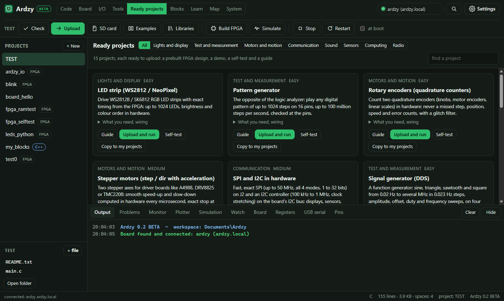

# Ardzy 0.3 BETA

**The Antminer S9 control board, used like an Arduino.**

The control board of an old Antminer S9 bitcoin miner has a Xilinx **Zynq XC7Z010**: two ARM cores
running Linux plus a real FPGA, 512 MB of RAM, Ethernet and about 50 free pins. These boards are
cheap to find. Ardzy turns one into a friendly development board: write an Arduino sketch, a Python
program or a Verilog design on your PC, press **Upload**, and it runs on the board.

> **BETA:** Ardzy 0.3 works and is used every day on a real board, but it is a test version.
> Some parts may still change, and you may find bugs. Please report them in
> [Issues](../../issues). Use it at your own risk: it is hobby software for hardware you own.



## What you get

- **A clean SD card image**: U-Boot 2026.07, Linux 6.18, Debian 13, built 100 % from source by the
  scripts here. Nothing of the original Bitmain firmware is used, and the board's NAND is never touched.
- **The Ardzy app for Windows**: finds the board on the network by itself, and has everything inside:
  - **Code**: Arduino C++ sketches (`setup()` / `loop()`), Python, C, C++, Shell (bash), Perl, ARM assembly,
    JavaScript (Node.js), Lua, Go, Rust and Verilog, with Check, Upload, examples, the Arduino library list,
    a serial-style Monitor, a Plotter, and compiler errors marked in the editor.
  - **Build FPGA without Vivado**: Yosys + nextpnr + Ardzy's own bitstream writer, built in.
  - **Simulation**: Verilog testbenches run on the PC (Icarus Verilog) with the waves drawn in the app.
  - **Blocks**: programs made by snapping blocks together, like Scratch, and **FPGA blocks** for hardware.
  - **Learn**: 10 FPGA lessons with interactive drawings, quizzes and a working project each.
  - **Ready projects**: 19 FPGA projects (LED strips, VGA, audio, a RISC-V CPU, SHA-256, FM radio,
    and AI: a network that reads handwritten digits, a small language model that writes text, a network
    that draws new digits, and AI Studio: all three much bigger, streamed from the board's DDR memory,
    with a reader you can teach your own handwriting)
    with self-tests and guides.
  - **Instruments** in the FPGA: logic analyzer, PWM / signal generators, frequency meters, UART, I2C.
  - **Board, I/O, Map, System** views: every pin, the board drawn to scale, Linux processes, logs, updates.
  - **Languages**: English, Greek, Russian. **Settings**: colours, size, fonts and more.

## New in 0.3

The app and the board's system are both 0.3. The board's system has the same boot loader, Linux and Debian as 0.2
(tested on the real board); what is new there are the Ardzy files: the signal analyzer, the board profiles and the
libraries. A board with 0.2 updates in a few seconds, without a restart (see [Flash and start](#flash-and-start)).

- **More programming languages**: C++, Shell (bash), Perl and ARM assembly are built into every board;
  JavaScript (Node.js), Lua, Go and Rust install with one click (Settings, Languages: the PC downloads them
  from Debian and the board installs them, the board needs no internet). Every language has an `ardzy`
  library in its new projects: LEDs, buzzer, buttons, FPGA registers and `watch()`.
- Clearer app: the status bar shows what the board runs, the FPGA design and its temperature; the AI screen
  shows the real engine clock.
- **A second board: the EBAZ4205** (the control board of Ebang miners, also a Zynq XC7Z010, 256 MB). Same app,
  same tools; its SD card image is built in the app (Build an image, in WSL). Not yet tested on a real
  EBAZ4205. See [Other boards](#other-boards-ebaz4205) below.
- **Tools from the Arduino IDE and Vivado**: Auto Format (Ctrl+T); rename, duplicate, archive (zip) and delete
  projects and files (right-click, deleted items go to `projects/_trash`); for FPGA projects a **build report**
  (LUTs, flip-flops, block RAM, DSPs, pins against the chip, and each clock's speed) and **I/O planning** (a pin
  for every port from the board's list, written into `io_plan.xdc`); a property set twice in the constraints
  now keeps the later value (like Vivado) instead of stopping the build. The build report also lists the
  **slowest path** of every clock (logic levels, time in logic and in wires, the lines of your Verilog on it).
- **Signal analyzer inside the FPGA** (like Vivado's ILA): mark signals with `(* mark_debug *)`, build and upload;
  then Simulation, Analyzer (board): a trigger (at once, is, becomes, changes), up to 4096 samples around it,
  shown as waves and saved as `analyzer.vcd`. It talks to the ARM through EMIO GPIO, so it works in every design.
  Tested on the real S9: a counter at 100 MHz (every sample, no gaps), PWM outputs (duty and period exact),
  every trigger kind, a trigger seconds later, and "Trigger now". It needs the board system 0.3.
- **Schematic** (project menu): the design drawn as blocks and wires, registers and operators inside your
  modules; click a module to go inside, click a block to find its line in the Verilog.
- **Moving around the code**: F12 goes to where a name is made (in any file of the project), Shift+F12 lists
  every use, Ctrl+Shift+R renames a name in every file; Include library for sketches; a right-click menu in the editor.
- **A second style** like thechryso.com (Settings, Look, Style), with colours in the editor and the terminals.
- **Fixes**: the app window now keeps its settings (style, theme, editor, language, layout) after you close it;
  they were lost at every start before. Simulate works without a testbench and in the packaged app. Build FPGA
  no longer reads a testbench (`*_tb.v`) as part of the design.
- **Settings**: one Save button for everything, and Save / Load settings to a file (to move them to another PC).
- **Make your SD card image in the app**: choose the board, the settings, the languages and projects the board
  gets after its first start; or build a whole image from the sources (in WSL) with your own Debian packages,
  example projects and version.

## New in 0.2a

- **AI in the FPGA**: four new ready projects. 16 reads handwritten digits, 17 is a small language model that
  writes text, 18 draws new digits, and 19 **AI Studio** runs all three much bigger, with the weights streamed
  from the board's DDR memory (about 100 times faster than the ARM), and learns your own handwriting.
  They open in their own screen in the app (Read, Write, Draw).
- The app opens from a downloaded zip, and new users get the example projects.

## Quick start

You need: an Antminer S9 control board, a 12 V supply (6-pin PCIe plug), a microSD card (4 GB or more),
an Ethernet cable and a Windows PC.

1. Download from [Releases](../../releases): `Ardzy-0.3-BETA-windows.zip` and `Ardzy-0.3-sdcard.img.xz`.
2. Unzip the app and start `Ardzy.exe`. Press **SD card**, choose the image and your card, Write.
   (balenaEtcher works too.)
   The app is not code-signed, so the first time Windows may show "Windows protected your PC":
   click **More info**, then **Run anyway**.
3. Set the boot jumpers to SD card (**JP2 = 1, JP4 = 1**), put the card in, connect Ethernet, power on.
4. Wait about 2 minutes. The app finds **ardzy.local** by itself.

The default login is **root / root**: change it (App: System, Settings; or `passwd` over SSH, or
`password = ...` in `ardzy.txt` on the card) before you connect the board to a network you share.

## Other boards: EBAZ4205

The EBAZ4205 (from Ebang miners) has the same chip as the S9, 256 MB DDR3, Ethernet, two LEDs, two buttons
and three 2x10 headers (DATA1, DATA2, DATA3) with 42 FPGA pins. Ardzy supports it from its published pin maps
and has tested it in the emulator; **it has not been tested on a real EBAZ4205 yet**: please report how it goes.

- **Hardware**: the board boots from NAND as it comes. For the SD card, mount the microSD slot (U7) and
  short resistor R2577 (boot mode SD); to power it from the J4 connector, short diode D24.
- **SD card**: in the app, SD card, Board EBAZ4205. Build its image with **Build an image ...** (WSL), or
  from the sources: `BOARD=ebaz4205 bash scripts/02_build_uboot.sh`, `03b_board_dtb.sh`, `05_make_image.sh`.
- **The Ethernet goes through the FPGA** (EMIO, MII PHY IP101GA): U-Boot loads the Ardzy base design
  (`base.bit` on the card) before Linux, and **the built-in FPGA build adds the Ethernet connection (and the
  two LEDs, when your design does not use their pins) to every design** for this board, so the network stays
  up whatever you load. Designs built for another board (or with Vivado) are refused at upload.
- **What works the same**: Python, C, C++, every language, Arduino sketches (pins `DATA1_5` .. `DATA3_20`,
  `LED_BUILTIN` = the green LED, `BUTTON_S2` / `BUTTON_S3`), the I/O and Tools views (the same pin-control
  design, with this board's pins), the simulation. The ready projects are made for the S9's pins: copy one
  and change its `.xdc`.
- Its profile (every pin, LED, button, how it boots) is `boards/ebaz4205/board.json`; the app's Pins tab and
  Map view show it. New boards are added the same way: a folder in `boards/`.

## Documentation

The full illustrated guides are in [`docs/`](docs/index.html): the hardware, every pin, the board
reference manual, the app, the FPGA projects and the lessons.

## Build it yourself

- **SD card image**: the scripts in [`scripts/`](scripts) (WSL Ubuntu, as root), see
  [Rebuild everything](#rebuild-everything-wsl-ubuntu-2004-as-root) below.
- **Windows app**: Python 3.12 and `python -m pip install pywebview pyinstaller pyserial pyaudiowpatch numpy`.
  The app needs the FPGA tools in `pc_app\tools` (too big for git): copy the `tools` folder from
  the release zip (`_internal\tools`) or build them with `pc_app\fpga\make_toolchain.sh` (MSYS2).
  Then run `pc_app\build_exe.bat`. For a quick test without building: `python pc_app\ardzy_app.py`.

## License

Copyright (C) 2026 chryso.

Ardzy is free software: you can redistribute it and/or modify it under the terms of the
**GNU General Public License version 3** or (at your option) any later version, see [`LICENSE`](LICENSE).
If you share a changed version, keep this copyright notice and share your source code too.
The software Ardzy uses keeps its own licenses: see [`THIRD_PARTY_NOTICES.md`](THIRD_PARTY_NOTICES.md). Ardzy is not made or supported by Bitmain,
AMD/Xilinx or Arduino.

---

# Technical reference

Everything on the SD card is built from source here.

| Part | What | Built from |
|---|---|---|
| `BOOT.bin` | U-Boot **SPL** 2026.07 (replaces the Xilinx FSBL; sets up clocks + 512 MB DDR) | `scripts/02_build_uboot.sh` |
| `u-boot.img` | U-Boot 2026.07, official `bitmain_antminer_s9` board | same |
| `zImage` | Linux **6.18** (Xilinx tree, tag xilinx-v2026.1), compressed swap (zram) | `scripts/03_build_kernel.sh` |
| `system.dtb` | our own clean device tree (ARM side only) | `kernel/zynq-antminer-s9.dts` |
| `boot.scr` | starts Linux; a new kernel is tried once and replaced by the old one if it fails | `scripts/05_make_image.sh` |
| `ardzy.txt` | board settings: name, password, network, time zone, SSH, what loads at power-on | same |
| root partition | **Debian 13 (trixie)** + the `ardzy` tools + Arduino core | `scripts/04_build_rootfs.sh` |

At power-on the **pin-control** FPGA design is loaded (49 pins, PWM, UART, logic analyzer, fans).
Your own designs replace it while Linux runs.

## The Ardzy app (Windows)
Start `pc_app\dist\Ardzy\Ardzy.exe` (or `Ardzy.exe` from the release zip). It finds the board by itself (UDP
port 41414, also over a direct cable). Everything is inside the app, nothing else to install:
- **Code**: Arduino C++ sketches (`setup()` / `loop()`), Python, C, C++, Shell, Perl, ARM assembly, JavaScript,
  Lua, Go, Rust, Verilog. **Check**, **Upload** (Ctrl+U),
  **Examples** (16), **Libraries** (the Arduino Library Manager list), Monitor with input, Plotter.
- **Build FPGA** without Vivado: Yosys + nextpnr + Ardzy's own bitstream writer (`pc_app\tools\fpga`,
  library `pc_app\fpga\hdl`). Vivado still works if chosen in Settings.
- **Board**, **I/O**, **Tools** (logic analyzer, PWM, frequency meters, UART, I2C), **Map** (the board drawn to scale or
  as a photo, nets, pin search, pin table), **System** (processes, services, logs, register explorer, speed tests,
  settings, system update).
- **FPGA blocks** (Blocks view, + FPGA design): hardware from blocks, turned into `top.v` + `pins.xdc` + `main.py`
  (`pc_app\ui\fblocks.js`); Simulate and Build and run from the same view.
- **Blocks**: programs made by snapping blocks together, like Scratch; they become an Arduino sketch
  (`pc_app\ui\blocks.js`, Blockly in `pc_app\ui\vendor\blockly`). **Learn**: 10 FPGA lessons and ideas.
  **Ready projects**: 19 FPGA projects with self-tests and guides; the AI ones open in their own screen.
- **App settings** (gear): languages English / Greek / Russian (`pc_app\ui\i18n.js`, Blockly msg el/ru), look (accent, background
  palettes, size, font, density, corners, motion), text, behaviour, export / import / reset (`pc_app\ui\settings.js`).
- **Simulation** (bottom tab, F6): Verilog testbenches run on the PC with Icarus Verilog (`pc_app\tools\icarus`, copied to
  `%LOCALAPPDATA%\Ardzy\icarus` because Icarus can not work in folders with spaces), waves drawn in the app
  (`pc_app\fpga\sim.py`, models `pc_app\fpga\simlib\ardzy_sim.v`, viewer `pc_app\ui\simview.js`).
- **Watch** (bottom tab): live values of the running program (`Ardzy.watch()`, `ardzy.watch()`), recordable to CSV.
  **Data logger** (Board view): the board records sensors, pins and program values to the SD card by itself
  (`board/opt/ardzy/web/datalog.py`, service `ardzy-logger`, logs in `/var/lib/ardzy/logs`).
- **SD card**: writes and checks the image and puts the board settings on it.

Rebuild the exe with `pc_app\build_exe.bat` (needs `pc_app\tools\fpga`, made by `pc_app\fpga\make_toolchain.sh`).

## Flash and start
1. App, **SD card** (or balenaEtcher): write `Ardzy-0.3-sdcard.img.xz` (Releases, or `out/release/` after a build) to a microSD card.
2. Boot jumpers on SD (JP2, JP4), card in the board, power on, wait about 2 minutes.
3. The app finds **ardzy.local**. Browser: http://ardzy.local. PuTTY: `ardzy.local`, **root / root**.

A board that already runs Ardzy: System, Settings and update, **Install update**
(`Ardzy-0.3-update.tar.gz` from Releases: the Ardzy files only, no restart needed). A board with 0.1 first takes
`Ardzy-0.2-update.tar.gz` (from the 0.2 release; new kernel, then Restart), then the 0.3 update.

## Projects
A **project** is a folder in `projects\`:

| File | What it does |
|---|---|
| `name.ino` (+ `.cpp`, `.h`) | Arduino sketch, compiled on the board (g++ 14), with the libraries it includes |
| `*.v` + `*.xdc` | FPGA design, built by the app (**Build FPGA**) into `name.bit` |
| `something.bit` | an FPGA design (part **xc7z010clg400-1**) |
| `main.py` | Python program, starts after the FPGA is loaded |
| `*.c` (+ `Makefile`) | C program, compiled on the board, then started |
| `main.cpp` | C++ program (g++, C++17), compiled on the board, then started |
| `main.sh`, `main.pl` | bash script, Perl program |
| `main.S` | ARM assembly (with any `.c` files), built by gcc on the board |
| `main.js`, `main.lua`, `main.go`, `main.rs` | JavaScript (Node.js), Lua, Go, Rust: installed once from the app (Settings, Languages) |
| `run.sh` | any shell commands instead of a program (for the languages above, the app makes one at upload) |
| `devices.dtsi` | optional: Linux devices for your FPGA IP (UIO, drivers) |

### `ardzy` commands on the board
```
ardzy list                  projects on the board
ardzy load blink            program FPGA + start program (a sketch is compiled first)
ardzy load blink --default  ...and load it again at every power-on
ardzy build sketch          compile a sketch only
ardzy pin-control           load the pin-control design
ardzy status / ardzy log -f    what runs / program output
ardzy stop / ardzy restart     the program
ardzy peek 0x41200000       read a register      ardzy poke 0x41200000 5   write one
ardzy config [key=value]    board settings (ardzy.txt)
ardzy update bundle.tar.gz  install a system update (then reboot)
```

### Python in your program
```python
from ardzy import MMIO
gpio = MMIO(0x41200000)
gpio.write(0, 0b1010)
print(gpio.read(0))
```

### Safety built in
- `ardzy` refuses bitstreams made for another chip (it checks the chip ID inside the file).
- **Watchdog**: if a design freezes the board, it reboots by itself after about 30 s.
- **Safe mode**: if the board crashes while starting the default project, the next boot skips it.
- **Safe kernel updates**: a new kernel is tried once; if Linux does not come up, the old one returns.
- The Ardzy FPGA library answers every address (0 for unknown ones), so a wrong address cannot
  freeze the board. Designs with Vivado's interconnect still can.

## Board facts used here
- Chip XC7Z010-1 CLG400 (IDCODE 0x03722093), 512 MB DDR3, console UART1 (ttyPS0), 115200.
- DDR settings: copied 1:1 from the FSBL that boots this board. Compared with the
  Vivado hardware file (.xsa) of the old design they differ in exactly 2 registers: row address bit 14 and
  tRFC. The FSBL is set up for 4 Gbit chips (1 GB map, 302 ns refresh); the xsa for 2 Gbit
  chips (512 MB map, 161 ns). This board really has 512 MB (2 Gbit chips), so both work.
- U-Boot keeps its settings in `uboot.env` on the boot partition (the board's own MAC address, saved at the first start, and the
  safe-update flags `ardzy_try`, `ardzy_tried`, `ardzy_rollback`).

## If it does not start (fallback)
Only for images built with your own `fallback/BOOT_fallback.bin` (the boot loader from the
board's original card; it is not in this repository). The boot partition opens in Windows. Rename `BOOT.bin` -> `BOOT_new.bin` and
`BOOT_fallback.bin` -> `BOOT.bin`. The fallback is the proven boot loader from the
old card. It starts the same new Linux. Details in `FALLBACK.txt` on the card.
A USB-serial adapter on the UART header (115200) shows where a boot stops.

## Rebuild everything (WSL Ubuntu-20.04, as root)
```
00_toolchain.sh   ARM GCC 14            00_qemu.sh         newer ARM emulator
01_get_sources.sh U-Boot + kernel src   02_build_uboot.sh  SPL + U-Boot
03_build_kernel.sh kernel + dtb         04_build_rootfs.sh Debian 13 + ardzy tools
05_make_image.sh  SD image -> out/      06_release.sh      out/release/*.img.xz
07_update_bundle.sh update bundle       test_os2_qemu.sh   emulator test of OS 0.2
07b_files_release.sh  a release of the Ardzy files only: update bundle + the earlier image with them
03b_board_dtb.sh  device tree of another board (BOARD=ebaz4205)
test_board_qemu.sh  emulator test of a board's image (BOARD=s9 or BOARD=ebaz4205)
test_uboot_for_qemu.sh  U-Boot for the emulator tests (keeps uboot.env like the board)
test_legacy_update_qemu.sh  emulator test of the 0.1 -> 0.2 update
```
BOARD=ebaz4205 before 02, 03b and 05 makes the EBAZ4205's boot loader, device tree and image
(`out/ardzy_debian13_ebaz4205.img`); the kernel and the Debian root file system are the same for every board.
ARDZY_EXTRA_PKGS="htop vim" before 04 adds Debian packages, ARDZY_EXAMPLES="..." before 05 chooses the
example projects. The app's **Build an image** runs these steps for you.
